```text
改善 (kaizen) — change for the better, in small continuous steps.
```

I'm a beginner who is moving from Python scripts into game development with **Unity**. This profile is a running log: it shows what actually exists and what is still in progress.

## whoami

```text
> engine     Unity — just getting started
> language   C# — basics, learning for Unity
> scripting  Python — wrote a small network monitoring tool
> 3d         Blender — low poly modeling, basic solid-color materials
> tools      Git — the basics
> data       SQLite
```

## stack


## projects

| status | project | notes |
| :----: | ------- | ----- |
| ✅ shipped | [Network-Interface-Monitoring-Script](https://github.com/KaizenDew/Network-Interface-Monitoring-Script) | Python + SQLite tool for monitoring network interfaces (runs on WSL / Ubuntu) |
| 🛠️ next | first Unity project | not started yet — this row updates when it does |

## roadmap

- [x] publish a working tool (network monitor, Python + SQLite)
- [ ] build my first Unity project
- [ ] get more comfortable with C#
- [ ] get more comfortable with Git
- [ ] use my low poly Blender models inside a Unity project

## contact

[](https://github.com/KaizenDew)
[](https://www.linkedin.com/in/receptahaakg%C3%BCl)
[](https://www.artstation.com/kaizenn)
[](mailto:hello@receptahaakgul.com)

---

<sub>not a tagline. the actual project.</sub>
