<picture>
  <source media="(prefers-color-scheme: dark)" srcset="assets/header-dark.svg">
  
</picture>

Software developer. I mostly write Python, C# and TypeScript, and I like building tools I actually use every day: a voice-controlled desktop assistant, running apps, and the plumbing that lets AI coding agents remember what they did yesterday.

改善 (*kaizen*) means "change for the better". That's the whole workflow: small steps, each one checked before the next.

          

## Projects

| Project | What it is | Status |
| --- | --- | :---: |
| **Mira** | Turkish-speaking desktop AI assistant for Windows: voice, screen reading, 55 tools (windows, files, clipboard, Spotify, reminders). `Python` `FastAPI` `React` `SQLite` |  |
| **StreakRun** | Local-first Android running app with streaks, XP and rest days that don't break your streak. `Expo` `React Native` `TypeScript` `MapLibre` |  |
| **RITM** | Coached interval runs with optional Turkish voice cues, Health Connect / HealthKit. `Expo` `React Native` `TypeScript` |  |
| **Beynim** | Source-linked, Git-synced memory shared between Claude Code and Codex. `Python` `Markdown` `Git` |  |
| [**Network Interface Monitor**](https://github.com/KaizenDew/Network-Interface-Monitoring-Script) | Logs network interface stats (IP, netmask) into SQLite. Runs on WSL / Ubuntu. `Python` `SQLite` |  |

Only the network monitor is public for now. The rest live in private repositories.

## How I work

> **Small steps.** One change at a time, verified before the next.
>
> **Local first.** Data stays on the device unless it has to leave.
>
> **AI as a collaborator, not autopilot.** Agents get written rules and shared memory, and I review what they ship.

## Contact

