```text
改善 (kaizen) — change for the better, in small continuous steps.
```

I build things that make my own day easier: a Turkish-speaking desktop AI assistant, a shared memory for my AI coding agents, and running apps for my phone. I work side by side with AI agents (Claude Code, Codex) and ship in small, tested steps. This profile is a running log: it shows what actually exists and what is still in progress.

## whoami

```text
> backend    Python (FastAPI), C# / .NET
> frontend   React, TypeScript, Vite
> mobile     React Native + Expo
> data       SQLite, PostgreSQL
> ai         LLM tool-calling, TTS / voice, local image generation (ComfyUI + FLUX)
> workflow   AI-assisted development with Claude Code and Codex, Git
> 3d         Blender (low poly), some Unity / C# (paused)
```

## stack


## projects

| status | project | notes |
| :----: | ------- | ----- |
| 🛠️ active | **Mira** 🔒 | Turkish-speaking desktop AI assistant for Windows: FastAPI + WebSocket server, React HUD, SQLite memory, voice output, 55 tools (windows, files, clipboard, Spotify, screen reading, reminders) |
| 🛠️ active | **Beynim** 🔒 | a shared Markdown memory for Claude and Codex, synced across devices with Git |
| 🛠️ active | **StreakRun** 🔒 | local-first Android running app with Duolingo-style streaks, XP and badges (Expo + React Native, GPS tracking, MapLibre) |
| 🛠️ active | **RITM** 🔒 | coached interval runs with optional Turkish voice cues, HealthKit / Health Connect (Expo) |
| ✅ shipped | [Network-Interface-Monitoring-Script](https://github.com/KaizenDew/Network-Interface-Monitoring-Script) | Python + SQLite tool for monitoring network interfaces (runs on WSL / Ubuntu) |
| ⏸️ paused | **Night Shift: Dorm** 🔒 | Unity 3D anomaly horror game |

<sub>🔒 = private repository</sub>

## roadmap

- [x] publish a working tool (network monitor, Python + SQLite)
- [x] build a full-stack app (Python / .NET backend + React frontend)
- [x] build a mobile app with Expo
- [x] build a voice-enabled AI assistant with tool calling (Mira)
- [ ] get StreakRun / RITM fully working on a real phone
- [ ] make some projects public with proper READMEs

## contact

[](https://github.com/KaizenDew)
[](https://www.linkedin.com/in/receptahaakg%C3%BCl)
[](https://www.artstation.com/kaizenn)
[](mailto:hello@receptahaakgul.com)

---

<sub>not a tagline. the actual project.</sub>
