<picture>
  <source media="(prefers-color-scheme: dark)" srcset="assets/city-night.svg">
  
</picture>

<p align="center"><sub>改善 <b>kaizen</b> · change for the better, in small continuous steps</sub></p>

Hi, I'm **Kaizen**. I build tools that make my own day easier, and then keep making them a little better.
Above is my workbench. Every building is a real project. Switch GitHub to dark mode and the lights come on.

## 🏙️ the city

| | building | what lives inside | built with | status |
| :-: | --- | --- | --- | :-: |
| 🗼 | **mira** | a Turkish-speaking desktop AI assistant for Windows: it talks, sees the screen and runs 55 tools (windows, files, clipboard, Spotify, reminders) | Python · FastAPI · WebSocket · React HUD · SQLite | 🟢 building |
| 📚 | **beynim** | a shared, source-linked memory for my AI coding agents (Claude Code and Codex), synced across devices with Git | Python · Markdown · Git | 🟢 building |
| 🕰️ | **ritm** | coached interval runs with optional Turkish voice cues and HealthKit / Health Connect | Expo · React Native · TypeScript | 🟢 building |
| 🏟️ | **streakrun** | a local-first running app with Duolingo-style streaks, XP, badges and rest days that don't break your streak | Expo · React Native · SQLite · MapLibre | 🟢 building |
| 📡 | **[netmon](https://github.com/KaizenDew/Network-Interface-Monitoring-Script)** | watches network interfaces and logs IP / netmask stats into SQLite (WSL / Ubuntu) | Python · SQLite | ✅ standing |
| 🏗️ | **next ?** | the empty plot. Something new gets hoisted here soon. | — | 🚧 |

<sub>Only netmon is public right now. The others live in private repos while they grow up.</sub>

## 🧰 the workbench

```text
backend   Python (FastAPI) · C# / .NET
frontend  React · TypeScript · Vite
mobile    React Native · Expo
data      SQLite · PostgreSQL
ai        LLM tool calling · TTS / voice · local image generation (ComfyUI + FLUX)
craft     Blender (low poly) · Git
```

         

## 📐 building code

The rules every building on this bench follows:

1. **Small blocks.** One change at a time, and each one is checked before the next goes on top.
2. **Local first.** Data stays on your device unless it really needs to leave.
3. **AI is a partner, not autopilot.** I build with Claude Code and Codex, and give them a shared memory (beynim) so they remember decisions and don't make them up.
4. **Honest status.** If it isn't done, this page says so.

## 🗺️ construction plan

- [x] put up the first building (netmon)
- [x] build a full-stack app: Python / .NET backend + React frontend
- [x] build a voice assistant with tool calling (mira)
- [x] give my AI agents a shared memory (beynim)
- [ ] get streakrun and ritm running on a real phone, every day
- [ ] open some of the city to the public, with proper READMEs
- [ ] fill the empty plot

## ✉️ say hi


<p align="center"><sub>the city is never finished. that's the point.</sub></p>
